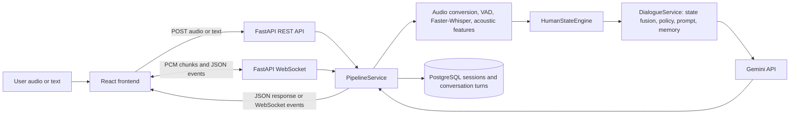

# HSIF — Human State Intelligence Framework

HSIF is a voice-enabled conversational AI demo that combines speech transcription, speech-derived human-state estimates, rule-based dialogue strategy selection, and a Gemini response. It explores how an assistant can use signals about **how something is said**, alongside the transcript of **what was said**, when preparing a response.

## Problem and approach

Most conversational pipelines pass recognized words directly to a language model. HSIF adds an analysis stage between speech recognition and response generation. The current implementation estimates emotion, hesitation, confidence, engagement, and cognitive load from acoustic features, audio activity, and transcript-derived features. A rule-based policy uses the resulting state to select a response strategy; Gemini generates the final text.

These state values are heuristic estimates for demonstration. They are not validated psychological or clinical measurements.

## Capabilities

- Upload audio or record through a live microphone.
- Transcribe audio with Faster-Whisper.
- Extract voice activity, pause, energy, pitch, and speech-rate features.
- Estimate a five-field Human State Representation (HSR).
- Select a dialogue strategy and build a prompt using recent conversation context.
- Generate text with Gemini and persist completed turns in PostgreSQL.
- View saved sessions, state summaries, and conversation history in the React UI.
- Send text messages through the same dialogue and response pipeline.

The account and login screens are a browser-local demo, not backend authentication. Settings are also stored in browser local storage; only the human-state and strategy display toggles currently affect the chat view.

## Architecture



## Audio and dialogue pipeline

### Audio processing

The upload endpoint accepts .wav, .mp3, .m4a, .ogg, .flac, and .aac files up to 25 MiB. It converts the file with ffmpeg to mono, 16 kHz, signed 16-bit PCM WAV. The speech service then runs an energy-based VAD, transcribes the converted audio, and extracts acoustic features. Temporary upload and converted files are removed after processing.

Faster-Whisper uses the base model on CPU with int8 compute. The VAD uses 30 ms frames and an energy threshold. Live microphone audio is sent as mono 16 kHz pcm_s16le chunks. The backend may send interim transcripts, then runs the full audio turn through the same final pipeline when it receives end_turn.

Empty or whitespace-only transcripts are rejected before dialogue generation. A no-speech error is returned rather than generating an assistant answer.

### Human-state estimates

The Human State Engine consumes the transcript and speech-service results, including duration, pauses, pitch, energy, and speech rate. The current HSR has five fields:

- Emotion: label and score
- Hesitation: score
- Confidence: score
- Engagement: score
- Cognitive load: score

Scores are normalized to the range 0–1. The current detectors and estimators are hand-written heuristics, with temporal smoothing enabled in the audio pipeline; they are not trained or calibrated clinical models.

### Dialogue strategy and Gemini

DialogueService fuses HSR values into a dialogue state, applies a rule-based policy, retrieves recent conversation context, and builds the prompt sent to Gemini. Strategies include acknowledge_frustration, reassure, simplify, reduce_information, slow_down, clarify, re_engage, continue, ask_follow_up, encourage, and normal_response.

The provider currently uses the gemini-3.6-flash model with a 30-second request timeout. It converts HTTP 429 quota errors into a quota-specific failure and does not retry them. HTTP 503 server errors are retried up to three attempts with a short backoff; other failures propagate. Availability and quota depend on the configured Google AI account. A failed generation is surfaced as an error and is not stored as a successful conversation turn.

## PostgreSQL persistence

The SQLAlchemy models define two tables:

- sessions: string session ID, creation/update timestamps, and a relationship to turns.
- conversation_turns: generated ID, session foreign key, user and assistant messages, HSR JSONB, strategy, and creation timestamp.

Deleting a session cascades to its turns. The repository persists completed interactions after response generation and restores recent turns and state history when a pipeline session is initialized.

**Database setup note:** the app does not create tables at startup, and this repository does not include a migration or schema-bootstrap command. Start PostgreSQL and provision the schema represented by database/models.py before using persistence-backed endpoints. docker-compose.yml starts a local PostgreSQL service on loopback port 5434; it does not initialize application tables. Set `POSTGRES_PASSWORD` privately before starting it.

## REST API

The FastAPI application serves interactive API documentation at /docs when running locally.

| Method | Endpoint | Purpose |
|---|---|---|
| `GET` | `/health` | Health status |
| `POST` | `/api/v1/process?session_id={id}` | Process multipart audio field `audio`; returns speech, HSR, dialogue policy, and response |
| `POST` | `/api/v1/message?session_id={id}` | Process JSON body containing `message` |
| `GET` | `/api/v1/session/{session_id}/state` | Current HSR, trajectory, and state changes |
| `GET` | `/api/v1/sessions` | List saved sessions |
| `GET` | `/api/v1/sessions/{session_id}` | Load one session and its turns |

The upload endpoint returns HTTP errors for invalid or failed processing. No-speech errors return HTTP 400. Gemini quota, timeout, and other unexpected pipeline failures use HTTP 500 with a generic client-facing message; diagnostic details are logged by the backend.

## WebSocket protocol

Connect to `/ws/session/{session_id}` with a UUID session ID. Send a JSON `start_session` control message with audio format `pcm_s16le`, sample rate `16000`, and one channel. Then send raw binary PCM chunks. End a turn with a JSON `end_turn` message containing `turn_id`, or close the session with `end_session`. A `ping` control message receives `pong`.

Server events:

| Event | Meaning |
|---|---|
| `session_ready` | Session initialized and ready for audio |
| `speech_chunk` | Audio chunk processed for live activity information |
| `transcript_partial` | Interim transcript hypothesis |
| `transcript_final` | Final transcript and speech analysis |
| `human_state_update` | HSR for the completed turn |
| `dialogue_strategy` | Selected strategy and reason |
| `assistant_response` | Successful generated response |
| `error` | Failure; includes code, message, and recoverability |
| `session_ended` | Session closed normally |
| `pong` | Response to `ping` |

Relevant error codes include `LLM_QUOTA_EXHAUSTED`, `NO_SPEECH_DETECTED`, `PIPELINE_FAILED`, `AUDIO_TOO_LARGE`, `INVALID_PCM`, and `SESSION_INITIALIZATION_FAILED`. A failed turn does not emit `assistant_response`.

## Technology

- **Backend:** Python, FastAPI, Pydantic, SQLAlchemy
- **Speech:** ffmpeg, librosa, NumPy, Faster-Whisper, CTranslate2
- **Human-state and dialogue:** Python heuristic estimators, state fusion, rule-based policy, prompt builder, in-memory conversation context
- **LLM:** Google GenAI SDK and Gemini
- **Database:** PostgreSQL, psycopg, JSONB
- **Frontend:** React, Vite, React Router
- **Tests:** pytest, Node.js built-in test runner

## Repository layout

```text
ai/
  speech/                 Audio conversion, VAD, Whisper, acoustic features
  human_state/            Five HSR estimators, smoothing, trajectory tracking
  dialogue/               State fusion, policy, memory, prompt construction
backend/app/
  api/                    REST and WebSocket handlers
  services/               Audio/text pipeline and Gemini integration
  schemas/                REST response models
database/                 SQLAlchemy models, connection, repository
frontend/src/
  pages/                  Landing, login, signup, dashboard, chat, history, account, settings
  hooks/                  WebSocket session hook
  services/               Audio capture/upload and streaming error helpers
tests/                     Backend tests and optional local audio fixtures
frontend/tests/            Frontend Node tests
docker-compose.yml         Local PostgreSQL service
requirements.txt           Python dependencies
```

## Configuration

Set secrets in the environment or in a private, untracked `.env` file. Do not commit credentials. The backend requires `DATABASE_URL` at startup.

| Variable | Used by | Description |
|---|---|---|
| `GEMINI_API_KEY` | Backend | Required to initialize the Gemini provider |
| `DATABASE_URL` | Backend | SQLAlchemy PostgreSQL connection URL using the `postgresql+psycopg` driver |
| `VITE_API_BASE_URL` | Frontend | REST API base URL; defaults to `http://localhost:8000/api/v1` |
| `VITE_WS_BASE_URL` | Frontend | Optional WebSocket backend base URL; when unset it is derived from `VITE_API_BASE_URL` (`http` → `ws`, `https` → `wss`) and the trailing `/api/v1` path is removed |
| `VITE_AUDIO_UPLOAD_TIMEOUT_MS` | Frontend | Audio upload timeout in milliseconds; defaults to `180000` |

Set `DATABASE_URL` to a PostgreSQL connection URL matching your private database credentials and `GEMINI_API_KEY` to your own key. For Compose, also set `POSTGRES_PASSWORD` privately. In the frontend, copy `frontend/.env.example` to `frontend/.env.local` and adjust the values for your deployment. Leave `VITE_WS_BASE_URL` unset to derive the WebSocket URL from the API base URL, or set it to an explicit `ws://` or `wss://` backend base URL. The derived URL removes the final `/api/v1` segment and preserves any preceding proxy path prefix. `.env` and `.env.*` files are ignored; `.env.example` is allowed for non-secret templates.

For example, `https://api.example.com/api/v1` derives `wss://api.example.com`; `https://example.com/hsif/api/v1/` derives `wss://example.com/hsif`. The local default API URL derives `ws://localhost:8000`.

## Local setup

Prerequisites: Python, Node.js/npm, PostgreSQL, and ffmpeg available on PATH. The Faster-Whisper model may need to be downloaded the first time it is initialized.

1. Set `POSTGRES_PASSWORD` in the shell or private `.env` file, then start the local PostgreSQL service if using Compose:

   ```sh
   docker compose up -d postgres
   ```

2. Provision the database schema represented by database/models.py. The repository currently supplies no migration/bootstrap command.

3. From the repository root, create a Python environment, install dependencies, and configure `GEMINI_API_KEY` and `DATABASE_URL`:

   ```sh
   python -m venv .venv
   # Windows PowerShell:
   .\.venv\Scripts\Activate.ps1
   # macOS/Linux:
   source .venv/bin/activate
   pip install -r requirements.txt
   ```

4. Start the backend from the repository root:

   ```sh
   uvicorn backend.app.main:app --reload
   ```

5. In another terminal, install and start the frontend:

   ```sh
   cd frontend
   npm install
   npm run dev
   ```

The frontend defaults to http://localhost:8000/api/v1 for REST calls and Vite serves the UI at its development URL (normally http://localhost:5173). The backend CORS configuration allows localhost on port 5173.

## Tests and checks

From the repository root, with the Python environment active:

```sh
python -m pytest
```

Some tests use PostgreSQL integration and require the configured database. Speech tests that rely on local audio fixtures may skip when those fixtures are absent. Gemini provider tests use controlled clients; do not run evaluation/demo scripts that make external requests unless you intend to contact Gemini.

From frontend/:

```sh
npm test
npm run lint
npm run build
```

## Known limitations

- HSR estimators are heuristic and not validated for psychological, medical, or high-stakes use.
- Interim live transcription repeatedly transcribes the accumulated audio buffer; final transcription runs again on the complete turn. This can delay audio handling for that WebSocket connection.
- The in-memory pipeline/session cache is process-local; conversation records are stored in PostgreSQL, but live session objects are not shared across backend workers.
- Database schema provisioning and migrations are not included.
- The local account flow is not server-side authentication or authorization. API session IDs are not associated with authenticated users.
- Several settings are preference-only: language is not wired into backend transcription, and pause detection, history retention, and recording storage toggles do not change backend behavior.
- Live microphone streaming requires the configured WebSocket URL to be reachable from the browser; configure `VITE_WS_BASE_URL` when it cannot be derived from `VITE_API_BASE_URL`.
- Gemini quota is account-dependent; the application cannot increase provider quota and does not retry quota-exhausted requests.

## Future improvements

- Add database migrations and a documented schema bootstrap workflow.
- Reduce repeated interim transcription work while preserving the final full-recording pass.
- Replace demo-local account handling with a documented authentication design before multi-user deployment.
- Evaluate and calibrate HSR estimators with representative, consented data before making stronger claims about their accuracy.
