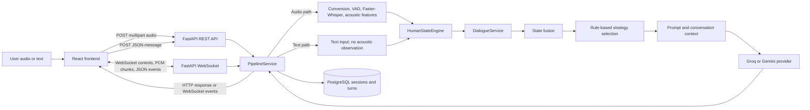

# HSIF — Human State Intelligence Framework

HSIF is a voice-enabled conversational AI capstone project. It combines speech transcription, acoustic feature extraction, a five-dimension Human State Representation (HSR), rule-based dialogue strategy selection, LLM-generated responses, and PostgreSQL conversation persistence.

HSIF treats two kinds of information separately: **what a person says**, represented by the transcript, and **how they say it**, estimated from speech-derived signals such as pauses, pitch, energy, and speaking activity. These estimates are experimental heuristics. They are not validated psychological or clinical measurements.

## Contents

- [Capabilities](#capabilities)
- [Architecture and request flow](#architecture-and-request-flow)
- [Audio and text processing](#audio-and-text-processing)
- [Human State Representation](#human-state-representation)
- [Dataset: CREMA-D](#dataset-crema-d)
- [Dialogue strategy and LLM providers](#dialogue-strategy-and-llm-providers)
- [Database design](#database-design)
- [Frontend](#frontend)
- [REST API](#rest-api)
- [WebSocket protocol](#websocket-protocol)
- [Technology stack](#technology-stack)
- [Repository structure](#repository-structure)
- [Configuration](#configuration)
- [Local setup](#local-setup)
- [Tests and evaluation](#tests-and-evaluation)
- [Known limitations](#known-limitations)
- [Future improvements](#future-improvements)
- [Screenshots](#screenshots)
- [Team](#team)

## Capabilities

- Send typed messages, upload an audio file, or record through a browser microphone.
- Transcribe speech with Faster-Whisper.
- Calculate VAD, pause, energy, pitch, and speech-rate features.
- Estimate five HSR dimensions and select a dialogue strategy.
- Generate responses with Groq by default or Gemini when selected in backend configuration.
- Store completed sessions and turns in PostgreSQL, then browse sessions and conversation history.
- Distinguish measured audio observations from text-only turns and audio observations whose required emotion features are unavailable.

The account and login flow is a browser-local demonstration. It is not server-side authentication. Settings are saved in browser storage; only the human-state and strategy visibility preferences affect the Chat page. Other preferences are not connected to backend behavior.

## Architecture and request flow



Audio and text inputs converge on dialogue processing, but only audio has acoustic observations. Text interactions are tagged as unmeasured; they do not reuse an earlier turn's audio measurements.

## Audio and text processing

### Audio path

`POST /api/v1/process` accepts an audio upload and a session ID. The endpoint validates the extension and size (25 MiB maximum), writes a temporary file, and runs the synchronous pipeline in FastAPI's thread pool. Audio preprocessing uses ffmpeg to convert to mono, 16 kHz PCM WAV. The speech path runs energy-based VAD, Faster-Whisper transcription, and acoustic feature extraction. Temporary files are cleaned up after the request.

The feature extractor uses VAD speech boundaries. It clips invalid ranges, merges overlapping ranges, and calculates pitch separately for each sufficiently long speech segment instead of joining segments across artificial boundaries. Pitch extraction skips segments shorter than 2,048 samples at 16 kHz. Energy is calculated over the selected speech audio. When the transcript is empty or whitespace-only, the pipeline stops before dialogue generation and persistence.

The Faster-Whisper service uses the `base` model on CPU with int8 compute. The live microphone sends mono 16 kHz `pcm_s16le` chunks over WebSocket. The server may transcribe accumulated audio for interim text; on `end_turn`, it runs final transcription over the complete turn.

### Text path

`POST /api/v1/message` accepts a JSON `message`. It passes the text to dialogue processing without fabricating audio features. Its HSR temporal metadata marks the observation invalid with source `text_only`. The UI displays the emotion as “Not measured” and suppresses score meters for that turn.

## Human State Representation

The HSR retains five fields. Scores use the normalized range 0–1, but they are implementation-specific heuristic estimates and have not all been scientifically validated.

| Dimension | Current inputs and approach |
|---|---|
| Emotion | Rule-based comparison of mean/minimum/maximum pitch and mean energy. Labels currently emitted are `neutral`, `excited`, `sad`, and `happy`; `unknown` is used when required features are unusable. The score is a heuristic score, not a calibrated probability. |
| Hesitation | Pause count and durations, silence duration, and speech duration. |
| Confidence | Heuristics based on pause frequency/duration, pitch range, and energy. This is not self-reported confidence. |
| Engagement | Heuristics based on speech activity, energy, pauses, and pitch range. |
| Cognitive load | Heuristics based on pause rate/duration, speech activity, pitch variation, and energy. |

An audio turn is marked `observation_valid: false` when required speech or emotion features are unusable. A valid neutral prediction remains a measured `neutral` result; it is not conflated with a missing measurement. The upload response adds `_temporal` metadata while retaining the existing five HSR dimensions. Persisted audio turns include the source `audio`; typed turns include `text_only`.

Temporal smoothing is enabled in the audio pipeline. Numeric HSR scores use an exponential update with `alpha=0.4`. Emotion confirmation count is currently `1`, so a different valid label can replace the prior label on the next observation. Invalid observations are returned as invalid and do not update the smoother's valid baseline.

Dialogue state fusion ignores invalid/unmeasured observations and uses internal neutral defaults for policy processing. Those defaults are not presented by the UI as measured human characteristics.

## Dataset: CREMA-D

CREMA-D (Crowd-sourced Emotional Multimodal Actors Dataset) was used for **evaluation**, not to train HSIF's detector. The repository contains the evaluation script and a recorded result artifact, but no CREMA-D audio or label files are tracked. The local dataset directory is ignored by Git; to reproduce the benchmark, obtain CREMA-D separately and place its WAV files under `evaluation/datasets/crema-d/AudioWAV/`.

CREMA-D defines six reference categories. The current detector emits four named emotion labels plus `unknown`; only three detector labels directly match CREMA-D categories.

| CREMA-D category | Directly supported by current detector? |
|---|---|
| Anger | No |
| Disgust | No |
| Fear | No |
| Happy | Yes (`happy`) |
| Neutral | Yes (`neutral`) |
| Sad | Yes (`sad`) |

HSIF also emits `excited`, which is not one of the six CREMA-D labels. The evaluation script decodes CREMA-D filename codes to the dataset's category names, but does **not** map `excited` to `happy` or otherwise invent a label equivalence. Unsupported classes remain visible in the full evaluation.

The [recorded benchmark run](evaluation/results/cremad_emotion_20261105T171105Z_1a23bbc0.json) processed 7,442 recordings successfully. Its full six-category evaluation reported **21.61% accuracy** and **0.1169 macro-F1**. The evaluation restricted the *ground-truth subset* to happy, neutral, and sad and reported **44.31% accuracy** and **0.4395 macro-F1**. These are results from the recorded run, not a claim of general recognition performance. CREMA-D consists of acted speech; the detector is heuristic, and neither result establishes real-world, cross-speaker, or psychological validity.

## Dialogue strategy and LLM providers

`DialogueService` passes HSR through rule-based state fusion, selects a policy strategy, retrieves conversation context, and builds an LLM prompt. Current strategies include `acknowledge_frustration`, `reassure`, `simplify`, `reduce_information`, `slow_down`, `clarify`, `re_engage`, `continue`, `ask_follow_up`, `encourage`, and `normal_response`.

Groq is the default text-generation provider. The adapter uses Groq's OpenAI-compatible chat-completions HTTP API through `httpx`; the default model is `openai/gpt-oss-20b`. Gemini remains available by setting `LLM_PROVIDER=gemini` and providing its API key. Provider selection and credentials are validated at backend startup.

| Provider | Defaults and behavior |
|---|---|
| Groq | 45-second timeout, 2,048 output-token limit, and at most one retry for transient HTTP 500/502/503/504 responses (0.25-second delay). Timeouts and quota/rate-limit errors are not retried. A `finish_reason` of `length` raises an incomplete-response error, so a truncated answer is not persisted as a successful turn. |
| Gemini | Source default model `gemini-3.6-flash`, 30,000 ms timeout, and up to three attempts for retryable 503/504 server errors with exponential delays. The output limit is 1,024 tokens. HTTP 429 quota/rate-limit responses are surfaced without retrying; `MAX_TOKENS` is treated as an incomplete response. |

Provider errors are converted to safe HTTP responses. Timeout, rate-limit, configuration/authentication, incomplete-response, and upstream failures do not expose provider keys or raw traceback details to HTTP clients. Automated provider tests use controlled responses; they do not verify live Groq or Gemini availability.

## Database design

HSIF uses PostgreSQL via SQLAlchemy and psycopg. The current models define:

| Table | Stored information |
|---|---|
| `sessions` | String session ID, creation/update timestamps, and relationship to conversation turns. |
| `conversation_turns` | Generated integer ID, session foreign key, user and assistant text, HSR JSONB, dialogue strategy, and creation timestamp. |

Deleting a session through the repository cascades to its turns. The repository lists sessions, loads turns in chronological order, and restores recent conversation and HSR state when a process-local pipeline session is initialized. Completed turns are written after successful response generation.

The application does not create tables at startup. No migration system or checked-in schema bootstrap script is present. `Base.metadata.create_all` can create missing model tables in a fresh local database, but it does not migrate an existing schema. Review and provision schemas deliberately before using an existing database.

The supplied Compose service runs PostgreSQL on `127.0.0.1:5434` and uses a named volume. Its database name and role are configured in Compose; `POSTGRES_PASSWORD` must be supplied privately. Changing that environment value does not rotate a password in an already initialized PostgreSQL volume.

## Frontend

The React application has routes for the landing, login, signup, dashboard, chat, history, account, and settings pages. The dashboard summarizes stored sessions and turns. Chat supports text submission, audio upload, and live microphone streaming. Its Human State panel displays measurements only when the current audio observation is valid. History lists sessions and opens saved conversation turns with their strategy and state metadata.

The account prototype stores account data, including the demo password, in browser `localStorage`; login is local to that browser. There is no backend identity, password hashing, session ownership, or per-user authorization. Logout clears the local user and active session reference; it does not delete PostgreSQL conversations.

Settings persist in `localStorage`. The Chat page currently uses the “Show human state panel” and “Show recommended strategy” settings. Speech language, pause detection, history retention, and recording storage are preference-only and do not change backend behavior. Recording storage is not implemented.

## REST API

The interactive API documentation is available at `/docs` when the backend is running.

| Method | Path | Request and purpose |
|---|---|---|
| `GET` | `/health` | Backend health status. |
| `POST` | `/api/v1/process?session_id={id}` | Multipart form field `audio`; processes an audio turn and returns speech results, five HSR fields plus temporal metadata, dialogue strategy, and assistant response. |
| `POST` | `/api/v1/message?session_id={id}` | JSON body `{"message": "..."}`; processes a text-only turn and returns user message, unmeasured HSR metadata, dialogue data, and response. |
| `GET` | `/api/v1/session/{session_id}/state` | Current state and its trajectory/changes for that process-local session. |
| `GET` | `/api/v1/sessions` | Saved session summaries. |
| `GET` | `/api/v1/sessions/{session_id}` | One saved session with conversation turns. |

Audio uploads are limited to 25 MiB and supported extensions are validated by the endpoint. Empty transcription is rejected before dialogue generation. Provider failures return safe error details with appropriate HTTP status codes; for example, a rate/quota limit is HTTP 429 and an upstream timeout is HTTP 504.

## WebSocket protocol

Connect to `/ws/session/{session_id}` with a UUID session ID. Send a JSON `start_session` control message specifying mono `pcm_s16le` audio at 16,000 Hz, then send raw binary PCM chunks. Send `end_turn` with a `turn_id` to run final processing over the accumulated turn audio. `end_session` closes the session; `ping` receives `pong`.

Important server event types are:

| Event | Purpose |
|---|---|
| `session_ready` | Session accepted and ready for audio. |
| `speech_chunk` | Chunk-level speech activity result. |
| `transcript_partial` | Interim transcript. |
| `transcript_final` | Final transcript and speech analysis for a completed turn. |
| `human_state_update` | HSR and temporal validity metadata. |
| `dialogue_strategy` | Selected strategy and reason. |
| `assistant_response` | Successfully generated response. |
| `error` | Error `code`, safe `message`, and `recoverable` flag. |
| `session_ended` / `pong` | Normal session closure / ping response. |

Known error codes include `NO_SPEECH_DETECTED`, `LLM_INCOMPLETE_RESPONSE`, `LLM_QUOTA_EXHAUSTED` (Gemini quota handling), `PIPELINE_FAILED`, `AUDIO_TOO_LARGE`, `INVALID_PCM`, and session/control validation errors. A failed generation does not emit a successful `assistant_response`. WebSocket rate-limit failures are reported through the pipeline error path; the HTTP endpoint has explicit provider status mapping.

## Technology stack

- **Backend:** Python, FastAPI, Pydantic, Uvicorn
- **Audio:** ffmpeg, librosa, NumPy, energy-based VAD, Faster-Whisper, CTranslate2
- **HSR and dialogue:** Python heuristic estimators, temporal smoother, state fusion, rule-based dialogue policy, prompt builder, in-memory conversation context
- **LLM:** Groq OpenAI-compatible HTTP API (default), Google GenAI SDK (optional Gemini)
- **Persistence:** PostgreSQL, SQLAlchemy, psycopg, JSONB
- **Frontend:** React, Vite, React Router, React Markdown
- **Tests:** pytest and Node.js built-in test runner; ESLint for frontend linting

## Repository structure

```text
ai/
  dialogue/                 Fusion, policy, memory, and prompt construction
  human_state/              HSR estimators, emotion detection, smoothing, tracking
  speech/                   Audio conversion, VAD, transcription, features, streaming
backend/app/
  api/                      FastAPI REST and WebSocket routes
  schemas/                  Pydantic response schemas
  services/                 Audio/text orchestration and LLM providers
database/                   SQLAlchemy models, connection, repository
evaluation/
  benchmark_cremad_emotion.py
  results/                  Recorded evaluation artifacts
frontend/src/
  components/               Shared UI components, including the HSR panel
  hooks/                    Streaming-session hook
  pages/                    Dashboard, History, Account, Settings, and auth routes
  services/                 Upload, session data, local session, and WebSocket helpers
tests/                      Backend unit and integration tests, local audio fixtures
frontend/tests/             Frontend tests
docs/                       Project documentation
docker-compose.yml          Local PostgreSQL service
requirements.txt            Python dependencies
```

The CREMA-D audio directory is excluded from version control; evaluation result artifacts are stored under `evaluation/results/`.

## Configuration

The backend loads environment variables from a private root `.env` file or the process environment. Do not put real credentials in source control. The repository's environment template should be reviewed before use; replace every credential field in a private copy with your own values. The backend requires `DATABASE_URL` and the key for the selected provider. Compose also requires `POSTGRES_PASSWORD`.

| Variable | Purpose |
|---|---|
| `LLM_PROVIDER` | `groq` (default) or `gemini`. |
| `GROQ_API_KEY` | Required when Groq is selected. |
| `GROQ_MODEL` | Groq model ID; default `openai/gpt-oss-20b`. |
| `GROQ_TIMEOUT_SECONDS` | Groq request timeout; default 45 seconds. |
| `GROQ_MAX_OUTPUT_TOKENS` | Groq maximum output tokens; default 2,048. |
| `GROQ_MAX_RETRIES` | Transient server-error retries; default 1, allowed range 0–1. |
| `GEMINI_API_KEY` | Required when Gemini is selected. |
| `GEMINI_TIMEOUT_MS` | Gemini timeout in milliseconds; default 30,000. |
| `DATABASE_URL` | SQLAlchemy PostgreSQL URL using the psycopg driver. |
| `POSTGRES_PASSWORD` | Private Compose password for initializing the local database role. |
| `VITE_API_BASE_URL` | Frontend REST API base; default `http://localhost:8000/api/v1`. |
| `VITE_WS_BASE_URL` | Optional explicit WebSocket base. Otherwise derived from API URL (`http` → `ws`, `https` → `wss`) with `/api/v1` removed. |
| `VITE_AUDIO_UPLOAD_TIMEOUT_MS` | Browser upload timeout in milliseconds; default 180,000. |

For a private root `.env`, set `LLM_PROVIDER`, `DATABASE_URL`, `POSTGRES_PASSWORD`, and the appropriate provider key. A local `DATABASE_URL` must use the Compose service's host port and the same database role/password configured for that database. For Gemini, set `LLM_PROVIDER=gemini` and `GEMINI_API_KEY`; Gemini's model is currently selected in source rather than through an environment variable.

Frontend variables can be placed in `frontend/.env.local`. The default API URL derives the local WebSocket origin. Vite's default UI origin is port 5173; the backend explicitly allows localhost and loopback origins on ports 5173 and 5174.

## Local setup

### Prerequisites

- Python 3.10 or newer (the current project environment was verified with Python 3.13).
- Node.js 20.19+ or 22.12+ and npm (required by the installed Vite version).
- Docker Compose, PostgreSQL, and ffmpeg on `PATH`.
- A Groq API key for the default provider, or a Gemini API key if selecting Gemini.

### Windows PowerShell

1. Create a private root `.env` with `DATABASE_URL`, `POSTGRES_PASSWORD`, `LLM_PROVIDER=groq`, and your own `GROQ_API_KEY`. Do not reuse credential values from a checked-in template. Compose configures the local database name and role; its published port is 5434.

2. Start PostgreSQL:

   ```powershell
   docker compose up -d postgres
   ```

3. Create and activate a Python virtual environment, then install the backend dependencies:

   ```powershell
   py -3.13 -m venv .venv
   .\.venv\Scripts\Activate.ps1
   python -m pip install -r requirements.txt
   ```

4. The application does not initialize its schema. For a new, empty local database, provision the current SQLAlchemy tables once with:

   ```powershell
   python -c "from database.database import Base, engine; import database.models; Base.metadata.create_all(engine)"
   ```

   This only creates missing tables; it is not a migration for an existing schema.

5. Start the backend from the repository root:

   ```powershell
   uvicorn backend.app.main:app --reload --host 127.0.0.1 --port 8000
   ```

6. In a second terminal, install and run the frontend:

   ```powershell
   cd frontend
   npm ci
   npm run dev
   ```

The UI is normally available at `http://localhost:5173` (Vite may select another port if occupied). The backend health check is `http://127.0.0.1:8000/health`, and API documentation is `http://127.0.0.1:8000/docs`.

To use Gemini instead, set `LLM_PROVIDER=gemini` and provide `GEMINI_API_KEY` in the backend environment, then restart the backend. No frontend provider configuration is required.

## Tests and evaluation

Run backend tests from the repository root:

```powershell
python -m pytest -q
```

Some integration tests can connect to and write to the configured PostgreSQL database. Use a dedicated test database or inspect the selected tests before running them against a database containing user data.

Run frontend checks from `frontend/`:

```powershell
npm test
npm run lint
npm run build
```

The latest recorded **focused** verification for the recent implementation changes was: 75 backend tests passed, 38 frontend tests passed, frontend lint passed, and the production build passed. It was not an unrestricted full backend suite; PostgreSQL-backed integration tests that can write to the configured database were not included. These automated tests do not establish live Groq availability or emotion-recognition accuracy.

The optional CREMA-D evaluation script is `evaluation/benchmark_cremad_emotion.py`. It requires the separately obtained dataset at the path described in [Dataset: CREMA-D](#dataset-crema-d), processes all matching audio files, and writes timestamped JSON/CSV results under `evaluation/results/`. It does not train a model or call an LLM.

## Known limitations

- Emotion detection is a limited pitch/energy heuristic. Its CREMA-D evaluation has low full six-category accuracy and does not establish general emotion-recognition quality.
- Only happy, neutral, and sad directly overlap with CREMA-D's six reference categories; anger, disgust, and fear are unsupported. `excited` is an additional HSIF label without a CREMA-D mapping.
- HSR estimates are not calibrated probabilities, validated psychological measures, or suitable for clinical or high-stakes decisions.
- Demo accounts are browser-local; passwords are stored in local storage. The backend does not authenticate users, bind sessions to accounts, or enforce session ownership.
- Session pipeline objects and conversation context are cached per backend process. PostgreSQL persists turns, but in-memory session state is not shared between multiple workers.
- No database migration tool or automatic startup schema creation is included. `create_all` does not evolve an existing schema.
- The Settings page includes preferences that are not wired to the corresponding backend behavior.
- Live microphone availability depends on browser permissions, a reachable WebSocket endpoint, local audio devices, and provider availability.
- Groq and Gemini are external services subject to quotas, rate limits, outages, and model availability. No live provider request is verified by the automated test results above.
- Live interim transcription reprocesses accumulated audio periodically; final transcription processes the full turn again, which can delay longer recordings.

## Future improvements

- Evaluate emotion and other HSR dimensions on broader, labelled, representative speech datasets, with speaker-independent splits and calibrated uncertainty.
- Expand emotion label coverage only with an explicit, evaluated definition of each label.
- Add database migrations and a tested schema upgrade workflow.
- Replace browser-local demo accounts with a server-side authentication and authorization design before multi-user deployment.
- Reduce repeated interim transcription work while preserving the final full-recording transcription pass.
- Share or externalize in-memory session state if deploying multiple backend workers.

## Team

- Sanjana
- Thapaswini
- Krupa
- Jennie
